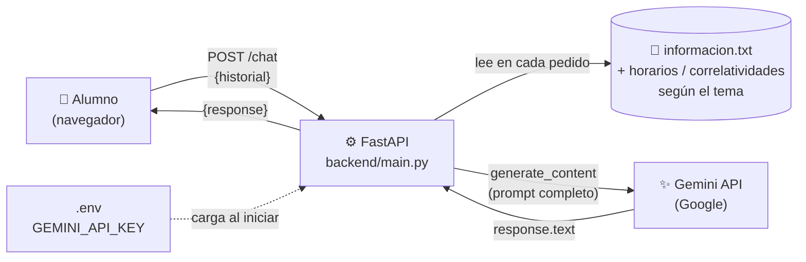
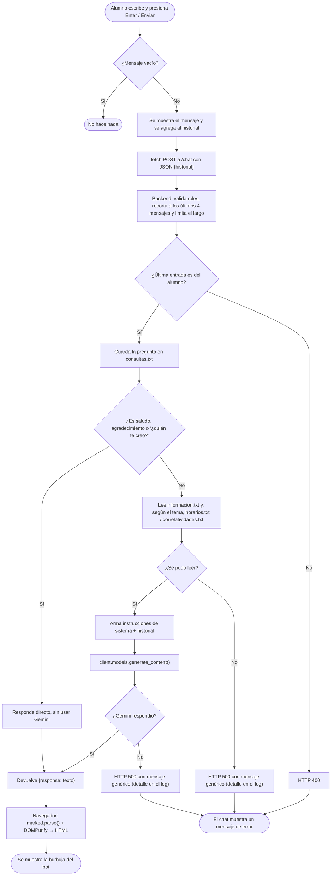
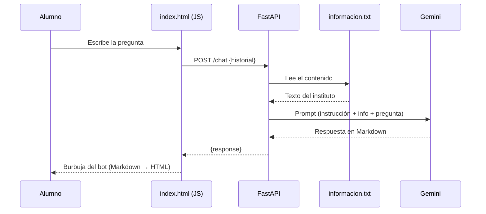

# Carlitos — Asistente virtual ISFDyT Nº 59

Chatbot embebible para la web del instituto. Los alumnos escriben una consulta en una burbuja de chat y reciben una respuesta generada por IA (Google Gemini) **basada en la información oficial del instituto**, que se mantiene en un simple archivo de texto.

---

## ¿Qué hace?

- Muestra un botón flotante con el robot de Carlitos que abre una ventana de chat.
- Envía la pregunta del alumno a un backend propio (FastAPI).
- El backend lee `backend/informacion.txt` (y, según el tema de la consulta, `horarios.txt` o `correlatividades.txt`), arma las instrucciones de Carlitos con esa información y consulta a Gemini junto con los últimos mensajes de la conversación.
- Devuelve la respuesta en Markdown, que el navegador convierte a HTML (listas, negritas, enlaces).

**Características**

- La API key de Gemini vive solo en el servidor (`.env`); nunca llega al navegador.
- La información del instituto se edita en `backend/informacion.txt` y se relee en cada pedido: **no hace falta reiniciar el servidor** para ver los cambios.
- **Memoria corta:** el bot recibe los últimos 4 mensajes de la conversación, así entiende preguntas como "¿y para segundo año?".
- **Ahorro de cuota:** los saludos, agradecimientos y la pregunta "¿quién te creó?" se responden sin consultar a Gemini.
- **Documentos por tema:** los horarios y las correlatividades solo se envían cuando el alumno pregunta por eso, para ahorrar cuota y no distraer al modelo.
- **Reglas de Carlitos:** prioriza el Régimen Académico Marco (RAM), cita la Resolución N° 4196/24 cuando lo usa, y dice que no sabe en lugar de inventar.
- **Registro de consultas:** cada pregunta se guarda en `backend/consultas.txt` y también en el log del servidor, para saber qué consultan los alumnos.
- **Seguridad:** el cliente no puede inyectar mensajes de sistema, hay límites de largo y los errores internos no se muestran al usuario.

---

## Estructura del proyecto

```
TpFinalChatYPaginaWeb/
├── Pagina-web-organizaciones/      ← sitio web (proyecto aparte)
└── Chat-Bot-organizaciones/        ← este proyecto
    ├── README.md
    ├── .gitignore
    ├── backend/
    │   ├── main.py                 ← API FastAPI
    │   ├── informacion.txt         ← base de conocimiento (se envía siempre)
    │   ├── horarios.txt            ← se envía solo si se pregunta por horarios
    │   ├── correlatividades.txt    ← se envía solo si se pregunta por materias/correlatividades
    │   ├── static/
    │   │   ├── chat-widget.js      ← widget para incrustar el chat en cualquier página
    │   │   └── robot.png           ← robot de Carlitos (botón flotante)
    │   ├── requirements.txt
    │   ├── .env                    ← GEMINI_API_KEY (no subir a Git)
    │   ├── consultas.txt           ← registro de preguntas (se crea solo, no subir a Git)
    │   └── .venv/                  ← entorno virtual (se crea al instalar)
    └── frontend/
        ├── index.html              ← interfaz original de Carlitos (versión independiente)
        └── demo-widget.html        ← página de prueba del chat-widget.js
```

> `main.py` calcula las rutas de todos sus archivos (`informacion.txt`, `horarios.txt`, `correlatividades.txt`, `.env`, `consultas.txt` y `static/`) a partir de **su propia ubicación**, por lo que funcionan aunque lances `uvicorn` desde otra carpeta. Todos viven junto a `main.py`, en `backend/`.

---

## Diagrama de arquitectura



## Diagrama de flujo de una consulta



## Diagrama de secuencia



---

## Requisitos

| Componente | Versión / detalle |
|---|---|
| Windows | 10 u 11 |
| [Git para Windows](https://git-scm.com/download/win) | incluye **Git Bash** (la terminal que usa esta guía) |
| Python | 3.10 o superior |
| Cuenta de Google | para obtener una API key de Gemini |
| Navegador | cualquiera moderno (Chrome, Edge, Firefox) |
| Internet | el backend consulta a Gemini y el frontend carga `marked` desde un CDN |

> Todos los comandos de esta guía se ejecutan en **Git Bash**, no en PowerShell ni en CMD. Las rutas se escriben con `/`, y `~` es tu carpeta de usuario de Windows. En esta guía las rutas parten de `TpFinalChatYPaginaWeb` (la carpeta del repositorio) y `<RUTA>` representa la carpeta que la contiene, sea cual sea en tu PC (por ejemplo `~/Documentos`).

---

## Instalación en Windows (Git Bash)

### 1. Instalar Git y Python

1. Instalá Git para Windows desde <https://git-scm.com/download/win> (con las opciones por defecto alcanza). Esto instala Git Bash.
2. Instalá Python desde <https://www.python.org/downloads/windows/> y **tildá "Add python.exe to PATH"** en el instalador.
3. Abrí Git Bash (clic derecho en una carpeta → *Open Git Bash here*, o desde el menú Inicio) y verificá:

```bash
git --version
python --version
```

Si `python` no se reconoce o abre la Microsoft Store, probá con el lanzador de Windows:

```bash
py --version
```

En ese caso usá `py` en lugar de `python` en los pasos siguientes (solo para crear el entorno virtual; una vez activado, `python` funciona normalmente).

### 2. Obtener la API key de Gemini

1. Entrá a <https://aistudio.google.com/apikey> con tu cuenta de Google.
2. Creá una API key y copiala.

### 3. Ubicarse en el proyecto

El proyecto ya está dentro del repositorio del TP final (`TpFinalChatYPaginaWeb`):

```bash
cd <RUTA>/TpFinalChatYPaginaWeb/Chat-Bot-organizaciones
ls
```

Si ya estás parado dentro de `TpFinalChatYPaginaWeb`, alcanza con `cd Chat-Bot-organizaciones`.

Debe mostrar `README.md  backend/  frontend/`. Luego entrá al backend, que es desde donde se trabaja:

```bash
cd backend
```

> Si clonás el repositorio en otra PC, el `.env` y el `.venv` **no vienen** con el código: hay que crearlos (pasos 4 y 6).

### 4. Crear y activar el entorno virtual

Desde `backend/`:

```bash
python -m venv .venv
source .venv/Scripts/activate
```

> En Windows el script de activación está en `.venv/Scripts/`, **no** en `.venv/bin/` como en Linux. No hace falta cambiar ninguna política de ejecución, a diferencia de PowerShell.

Cuando esté activo, el prompt muestra `(.venv)` al principio. Para salir del entorno: `deactivate`.

### 5. Instalar las dependencias

El proyecto ya incluye `backend/requirements.txt` (debe listar al menos `fastapi`, `uvicorn[standard]`, `python-dotenv`, `google-genai` y `pydantic`). Con el entorno activo, instalá todo:

```bash
python -m pip install --upgrade pip
pip install -r requirements.txt
```

### 6. Configurar la API key

Si todavía no existe `backend/.env`, creálo (reemplazá `tu_clave_aqui` por la clave real). Ojo: `ls` no lo muestra porque empieza con punto; usá `ls -a` para verlo:

```bash
cat > .env << 'EOF'
GEMINI_API_KEY=tu_clave_aqui
EOF
```

Verificá que quedó bien (sin espacios ni comillas alrededor de la clave):

```bash
cat .env
```

Y protegé los archivos sensibles para que Git no los suba:

```bash
cat > ../.gitignore << 'EOF'
.env
.venv/
__pycache__/
*.pyc
consultas.txt
EOF
```

Como `backend/` ya tiene una carpeta `__pycache__/`, verificá con `git status` que no esté versionada. Si aparece, sacala del repositorio (sin borrarla del disco):

```bash
git rm -r --cached __pycache__
```

### 7. Cargar la información del instituto

Editá `backend/informacion.txt` en **UTF-8**. Lo más cómodo es VS Code, si lo tenés instalado:

```bash
code informacion.txt
```

o con vim, que viene con Git Bash: `vim informacion.txt`. Si el archivo todavía está en la carpeta `Chat-Bot-organizaciones/`, movelo con Git para conservar su historial:

```bash
git mv ../informacion.txt informacion.txt
```

Ejemplo de contenido, ordenado por secciones:

```
== INSCRIPCIONES ==
Período: ...
Requisitos: ...

== CARRERAS ==
Profesorado de ...
Tecnicatura en ...

== CONTACTO ==
Secretaría: ...
Horario de atención: ...
```

### 8. Iniciar el backend

Desde `backend/` y con el entorno activado:

```bash
uvicorn main:app --host 127.0.0.1 --port 8000 --reload
```

Dejá esa terminal abierta (se detiene con `Ctrl + C`). Abrí una **segunda ventana de Git Bash** para el resto de los comandos.

Comprobá que funciona:

```bash
curl http://127.0.0.1:8000/
```

Debe responder algo como `{"status":"ok","message":"Asistente ISFDyT 59 con IA de Google"}`. Para probar el chat sin el frontend:

```bash
curl -X POST http://127.0.0.1:8000/chat \
  -H "Content-Type: application/json" \
  -d '{"historial":[{"role":"user","content":"¿Qué carreras hay?"}]}'
```

También podés abrir <http://127.0.0.1:8000/docs> en el navegador (documentación interactiva).

### 9. Abrir el frontend

Opción A: abrir `frontend/index.html` con doble clic, o desde Git Bash:

```bash
start ../frontend/index.html
```

Opción B (recomendada, más parecida a producción), en la segunda terminal:

```bash
cd <RUTA>/TpFinalChatYPaginaWeb/Chat-Bot-organizaciones/frontend
python -m http.server 5500
```

y abrir <http://127.0.0.1:5500/index.html>.

Hacé clic en 💬 y probá una pregunta.

### 10. Uso diario

Cada vez que quieras volver a levantar el proyecto:

```bash
cd <RUTA>/TpFinalChatYPaginaWeb/Chat-Bot-organizaciones/backend
source .venv/Scripts/activate
uvicorn main:app --host 127.0.0.1 --port 8000 --reload
```

---

## Archivos de conocimiento

Carlitos responde solo con lo que dicen estos archivos de `backend/` (se releen en cada consulta, sin reiniciar el servidor):

| Archivo | Cuándo se envía a Gemini | Qué debería tener |
|---|---|---|
| `informacion.txt` | Siempre | Datos generales: contacto, equipo, inscripción, planes de estudio, normativa, RAM, trámites de preceptoría |
| `horarios.txt` | Solo si el alumno habla de horarios (`horario`, `clases`, `turno`, `grilla`, días de la semana…) | Horarios por carrera, año y materia |
| `correlatividades.txt` | Solo si habla de materias, correlatividades, planes, carreras, cursar, rendir… | Correlatividades por carrera |

**Cómo se decide:** se miran únicamente los mensajes del alumno (los últimos 4), sin tildes, y alcanza con que una palabra *empiece* con la clave (`hora` coincide con `horas` y `horario`, pero no con `ahora`). Las palabras clave de cada documento están en `DOCUMENTOS_COMPLEMENTARIOS` dentro de `main.py`. Si se agrega un documento nuevo, se suma a esa lista.

Recomendaciones:

- **No repitas el mismo contenido en dos archivos.** El texto duplicado se envía dos veces y solo gasta cuota.
- **Revisá los enlaces:** cada URL de Drive debe estar completa. Si el texto se copió desde otra herramienta, pueden quedar restos como `[cite: 25]` o identificadores cortados, y el alumno recibiría un enlace roto.
- Un archivo complementario que falte no rompe nada: Carlitos responde con `informacion.txt` y lo registra en el log.

---

## Configuración

| Qué | Dónde | Detalle |
|---|---|---|
| API key | `backend/.env` → `GEMINI_API_KEY` | Obligatoria |
| Modelo de IA | `backend/.env` → `GEMINI_MODEL` (opcional) | Por defecto `gemini-3.5-flash`; si da error 404, poné un modelo disponible en tu cuenta |
| Prompt / reglas del bot | `backend/main.py` → `INSTRUCCIONES_BASE` | Acá se define el tono, la prioridad del RAM y qué hacer con temas ajenos |
| Información del instituto | `backend/informacion.txt` | Se relee en cada pedido |
| Nombre y respuestas directas | `backend/main.py` → `NOMBRE_BOT`, `SALUDOS`, `AGRADECIMIENTOS`, `RESPUESTA_CREADOR` | Se responden sin gastar cuota de Gemini |
| Documentos por tema | `backend/main.py` → `DOCUMENTOS_COMPLEMENTARIOS` | Archivo y palabras clave que lo activan |
| Memoria y límites | `backend/main.py` → `MAX_MENSAJES_HISTORIAL`, `MAX_CARACTERES_PREGUNTA`, `TEMPERATURA`; y `MAX_TOKENS_RESPUESTA` también como variable de entorno (800 por defecto) | Si las respuestas salen cortadas, subí `MAX_TOKENS_RESPUESTA` |
| Registro de consultas | `backend/consultas.txt` y log del servidor | Una línea por pregunta (`Consulta: ...` en el log) |
| URL del backend | `frontend/index.html` → `fetch('http://127.0.0.1:8000/chat')` (o la constante `API_URL`) | Cambiarla al publicar |
| Puerto | argumento `--port` de uvicorn | Si lo cambiás, actualizá también la URL del frontend |
| CORS | `backend/.env` → `ALLOWED_ORIGINS` (opcional) | Por defecto `*`; en producción poné el dominio real, por ejemplo `ALLOWED_ORIGINS=https://www.tu-dominio.com` |

---

## Solución de problemas (Git Bash)

| Síntoma | Causa probable | Solución |
|---|---|---|
| `source: .venv/bin/activate: No such file` | Ruta de Linux en un entorno de Windows | Usar `source .venv/Scripts/activate` |
| `python: command not found` o se abre la Microsoft Store | Python no está en el PATH o interfiere el alias de la Store | Reinstalar tildando *Add to PATH*, o usar `py -m venv .venv` |
| `uvicorn: command not found` | El entorno virtual no está activo | Ejecutar `source .venv/Scripts/activate` |
| `ModuleNotFoundError: No module named 'google'` | Faltan dependencias | Con el entorno activo: `pip install -r requirements.txt` |
| El chat dice *"Error al conectar con el servidor"* | El backend no está corriendo o la URL/puerto no coinciden | Verificar con `curl http://127.0.0.1:8000/` |
| HTTP 500 y en la consola `No se pudo leer ...informacion.txt` | El archivo no está en `backend/` o no es UTF-8 | Ponerlo en `backend/informacion.txt` |
| El servidor no arranca y dice `Falta GEMINI_API_KEY` | No existe `backend/.env` o la variable está mal escrita | Crear el `.env` (paso 6) |
| HTTP 500 y en consola `API key not valid` | Clave mal copiada o `.env` mal ubicado | Revisar con `cat .env` que esté en `backend/` y sin espacios ni comillas |
| HTTP 500 y `404 ... model not found` | Nombre de modelo inexistente para tu cuenta | Cambiar `model=` en `main.py` |
| HTTP 429 | Se superó la cuota de la API | Esperar o revisar los límites en Google AI Studio |
| `address already in use` en el puerto 8000 | Quedó otra instancia corriendo | `netstat -ano \| grep 8000` para ver el PID y luego `taskkill //PID <PID> //F` (con doble barra en Git Bash) |
| Tildes y ñ se ven mal | `informacion.txt` no está en UTF-8 | Guardarlo como UTF-8 (VS Code: barra inferior → *Save with Encoding*) |
| Error de CORS en la consola del navegador | El origen del frontend no está permitido | Agregar el origen a `ALLOWED_ORIGINS` en `backend/.env` |
| `.env` aparece en `git status` | Falta el `.gitignore` | Crearlo (paso 6). Si ya se subió: `git rm --cached backend/.env` y **generar una API key nueva** |
| El robot no aparece y se ve un círculo con un ícono | La imagen no se pudo cargar desde `/static/robot.png` | Verificá que exista `backend/static/robot.png` y abrí `https://TU-SERVIDOR/static/robot.png` |
| La primera respuesta tarda mucho (Render) | El servicio gratuito estaba dormido | Esperar unos segundos; el widget avisa. Ver "Despliegue en Render" |
| Carlitos no responde con los horarios | La pregunta no tiene ninguna palabra clave, o falta `horarios.txt` | Probá con "horarios" o "clases", y revisá `DOCUMENTOS_COMPLEMENTARIOS` y el log del servidor |

---

## Incrustar el chat en la página de una institución (`chat-widget.js`)

Para poner el chat en el sitio de otra institución no hace falta copiar HTML, CSS ni JavaScript: alcanza con **una línea**. `backend/static/chat-widget.js` es la interfaz de Carlitos empaquetada en un único archivo.

**Lo que trae (el diseño de `frontend/index.html`, más protecciones):**

- el **robot** como botón flotante, y una ventana estilo WhatsApp (pantalla completa en el celular);
- **modo claro/oscuro** (se recuerda mientras se navega) y botón para limpiar la conversación;
- **botones de preguntas frecuentes** (Carreras, Inscripciones, Constancia, Horarios, Contactos) con respuesta inmediata, sin gastar cuota;
- **dictado por voz** con el micrófono (si el navegador lo permite; si no, el botón se oculta). Chrome procesa el audio con el reconocimiento de voz de Google;
- **recordatorio** "¿Necesitás ayuda con algo más?" tras 2 minutos sin actividad;
- correos y el teléfono del instituto se vuelven **enlaces** (`mailto:` y `tel:`);
- aviso "el servidor está arrancando…" si la respuesta tarda más de 8 segundos (útil en planes gratuitos que se duermen);
- no depende de ninguna librería externa y vive dentro de un **Shadow DOM**: ni el tema de la página (WordPress, por ejemplo) rompe el chat, ni el chat rompe la página;
- muestra las respuestas sin interpretar HTML, por lo que no se pueden inyectar scripts;
- recuerda la conversación mientras el visitante navega por el sitio (solo en esa pestaña);
- lo sirve el propio backend en `/chat-widget.js` (y el robot en `/static/robot.png`), así que al actualizarlo en tu servidor se actualiza en todas las páginas (en unos 5 minutos).

### Uso

Antes de `</body>`, en la página donde se quiere el chat:

```html
<script src="https://TU-SERVIDOR/chat-widget.js" defer></script>
```

Si no se indica nada más, el widget le habla a `/chat` y toma el robot de `/static/robot.png`, ambos del mismo servidor que le entregó el archivo.

### Opciones (atributos `data-`, todos opcionales)

| Atributo | Para qué sirve | Ejemplo |
|---|---|---|
| `data-api` | URL del endpoint `/chat` (si no está en el mismo servidor) | `https://chat.tu-dominio.com.ar/chat` |
| `data-title` | Título de la ventana (por defecto `ISFDyT N° 59`) | `Asistente del Instituto` |
| `data-bot-name` | Nombre del asistente (por defecto `Carlitos`) | `Carlitos` |
| `data-welcome` | Primer mensaje (admite **negrita** y enlaces) | `¡Hola! Soy **Carlitos**.` |
| `data-placeholder` | Texto del campo de escritura | `Escribí tu consulta…` |
| `data-notice` | Aviso bajo el campo de escritura (`""` lo oculta) | `Respuestas orientativas.` |
| `data-color` | Color del encabezado y del botón Enviar (por defecto `#003b73`) | `#003366` |
| `data-position` | Lado de la pantalla: `right` o `left` | `left` |
| `data-avatar` | Imagen del botón flotante (por defecto el robot del servidor); `""` muestra un ícono simple | `https://sitio.com/robot.png` |
| `data-suggestions` | Preguntas frecuentes en JSON, o `none` para ocultarlas | `[{"label":"📚 Carreras","question":"¿Qué carreras hay?","answer":"Podés verlas en ..."}]` |
| `data-inactivity` | Segundos de inactividad antes del recordatorio (`0` lo desactiva) | `120` |

> Las respuestas de los botones de preguntas frecuentes son **texto fijo** (están en el widget): actualizalas cuando cambien los datos del instituto, para que coincidan con `informacion.txt`.

Ejemplo completo:

```html
<script src="https://chat.tu-dominio.com.ar/chat-widget.js"
        data-title="ISFDyT N° 59"
        data-color="#003b73"
        defer></script>
```

Desde la propia página se puede controlar con `IsfdytChat.abrir()`, `IsfdytChat.cerrar()` e `IsfdytChat.reiniciar()`; por ejemplo, un botón "Consultas" del menú: `<button onclick="IsfdytChat.abrir()">Consultas</button>`.

### Probarlo en tu PC

Con el backend corriendo (ver el paso 8), en otra terminal de Git Bash:

```bash
cd <RUTA>/TpFinalChatYPaginaWeb/Chat-Bot-organizaciones/frontend
python -m http.server 5500
```

Abrí <http://127.0.0.1:5500/demo-widget.html>. Esa página tiene estilos agresivos a propósito (botones rojos, bordes violetas) para comprobar que no afectan al chat.

### Sitio hecho solo con HTML, CSS y JS

Pegá la línea `<script>` antes de `</body>` en cada página donde quieras el chat (o en la plantilla común, si la hay).

### Sitio con WordPress

Funciona sin problemas si el sitio permite agregar scripts propios. Formas de hacerlo, de la más recomendable a la menos:

1. **Plugin para insertar código** (por ejemplo *WPCode* o *Insert Headers and Footers*): pegás la línea `<script>` en la sección **Footer** y se carga en todo el sitio. Sobrevive a los cambios de tema y no requiere tocar archivos.
2. **Código en el tema hijo (`functions.php`)**, o en un plugin propio, si hay un desarrollador a cargo:

   ```php
   add_action( 'wp_footer', function () {
       echo '<script src="https://chat.tu-dominio.com.ar/chat-widget.js" defer></script>';
   } );
   ```

   Hacelo en un **tema hijo**: si se edita el tema principal, una actualización borra el cambio.
3. **Bloque "HTML personalizado"** (o el widget HTML de Elementor y otros constructores): sirve para una sola página. WordPress elimina los `<script>` si el usuario no es Administrador, así que si "desaparece" al guardar, usá la opción 1.

Cosas a tener en cuenta:

- **WordPress.com:** los planes básicos no permiten scripts propios ni plugins. En un WordPress instalado en el propio servidor de la institución (WordPress.org) no hay ese límite.
- **Plugins de caché y optimización** (WP Rocket, Autoptimize, LiteSpeed, etc.) y **Cloudflare Rocket Loader** pueden aplazar, combinar o bloquear el script. Si el chat no aparece, excluí `chat-widget.js` de la minificación y la carga diferida.
- **Seguridad:** si el sitio tiene una política CSP, hay que permitir `script-src` y `connect-src` hacia el dominio del chat.
- **Quién tiene acceso:** hace falta una cuenta de Administrador (o que lo haga quien administra el sitio).
- **Plataformas cerradas** (Google Sites, versiones básicas de Wix y similares) no aceptan scripts propios: ahí el widget no se puede instalar.

### Qué necesita el servidor para que funcione en una página ajena

1. **HTTPS** en el subdominio del backend (si la página usa `https://`, el navegador bloquea un backend `http://`).
2. **CORS:** en `backend/.env`, `ALLOWED_ORIGINS=https://www.instituto.edu.ar` (el dominio exacto de la página; con y sin `www` si ambos responden).
3. **nginx** reenviando las dos rutas al backend:

```nginx
server {
    listen 443 ssl;
    server_name chat.tu-dominio.com.ar;
    # ssl_certificate ... (por ejemplo con Certbot)

    location = /chat {
        proxy_pass http://127.0.0.1:8000;
        proxy_set_header Host $host;
        proxy_set_header X-Real-IP $remote_addr;
        proxy_read_timeout 60s;
    }

    location = /chat-widget.js {
        proxy_pass http://127.0.0.1:8000;
        proxy_set_header Host $host;
    }
}
```

Solo se exponen esas dos rutas; la documentación automática (`/docs`) queda accesible únicamente desde el propio servidor.

---

## Despliegue en Render

Si el backend corre en Render, estos son los ajustes del servicio:

| Ajuste | Valor |
|---|---|
| Root Directory | `Chat-Bot-organizaciones/backend` |
| Build Command | `pip install -r requirements.txt` |
| Start Command | `uvicorn main:app --host 0.0.0.0 --port $PORT` |
| Variables de entorno | `GEMINI_API_KEY` (obligatoria); opcionales: `ALLOWED_ORIGINS`, `GEMINI_MODEL`, `MAX_TOKENS_RESPUESTA` |

Cosas a tener en cuenta:

- **No se sube el `.env`:** en Render las variables se cargan en el panel del servicio.
- **De OpenAI a Gemini:** el `requirements.txt` ahora usa `google-genai` en lugar de `openai`, y la clave es `GEMINI_API_KEY` en lugar de `OPENAI_API_KEY`.
- **Instalación en las páginas:** con la URL pública del servicio, la línea es `<script src="https://TU-SERVICIO.onrender.com/chat-widget.js" defer></script>`; el endpoint `/chat` y el robot se resuelven solos.
- **Planes gratuitos:** el servicio suele dormirse tras un rato sin uso y la primera consulta tarda en responder. El widget avisa a los 8 segundos ("el servidor está arrancando…") y espera hasta 60. Para evitarlo hace falta un plan que no se duerma.
- **Registro de consultas:** el sistema de archivos del servicio no es persistente salvo que se contrate un disco, así que `consultas.txt` puede perderse al reiniciar o volver a desplegar. Por eso cada consulta también se imprime en el log del servicio (`Consulta: ...`), que se ve en el panel de Render.
- **HTTPS y CORS:** Render ya entrega HTTPS; en `ALLOWED_ORIGINS` poné el dominio exacto de la página que muestra el chat.

---

## Antes de publicarlo en la web del instituto

1. **Backend accesible desde internet:** `127.0.0.1` solo funciona en tu máquina. Publicalo en un servidor/VPS (por ejemplo detrás de nginx con HTTPS) y cambiá la URL del frontend, preferentemente a una ruta relativa como `/chat`.
2. **CORS:** definí `ALLOWED_ORIGINS` en `backend/.env` con el dominio real del instituto, por ejemplo `ALLOWED_ORIGINS=https://www.tu-instituto.edu.ar`.
3. **Límite de uso:** cualquiera que conozca la URL puede consumir tu cuota de Gemini. Agregá un rate limit por IP (por ejemplo con `slowapi`).
4. **Seguridad del frontend:** sanitizá el HTML renderizado (DOMPurify) y usá `textContent` para el mensaje del usuario.
5. **Respuestas confiables:** agregá en el prompt una regla como *"si la respuesta no está en la información, decí que no lo sabés y sugerí contactar a secretaría"*.
6. **Ejecución continua en Windows:** para que el backend arranque solo y no dependa de una ventana abierta, podés registrarlo como servicio con [NSSM](https://nssm.cc/) o como tarea programada al inicio del sistema. Si el servidor final es Linux, el proyecto se despliega igual con systemd y nginx, solo cambia la activación del entorno (`source .venv/bin/activate`).

---

## Integración con la página web

El repositorio incluye `Pagina-web-organizaciones/`. Para sumar el chat a esa página:

1. Copiá el HTML del botón y de la ventana de chat, el CSS y el `<script>` de `frontend/index.html` dentro de la página (antes de `</body>`).
2. Incluí también los scripts de `marked` (y `DOMPurify`, si aplicaste la versión corregida).
3. Verificá que la URL del backend (`API_URL` o el `fetch`) apunte al servidor donde corre FastAPI, y que ese origen esté permitido en `ALLOWED_ORIGINS`.

---

## Limitaciones conocidas

- **Documentos por palabras clave:** `horarios.txt` y `correlatividades.txt` solo se agregan cuando la pregunta contiene alguna de las claves; si una consulta usa otras palabras, Carlitos responde solo con `informacion.txt`.
- **Memoria corta:** el bot recuerda solo los últimos 4 mensajes. Si la página usa el formato anterior (`{"message": "..."}`), el backend lo acepta, pero sin memoria.
- **Toda la información va en cada prompt:** funciona bien con un archivo chico; si crece mucho, conviene dividirlo en secciones y enviar solo las relevantes.
- **"Basándote estrictamente en…" es una instrucción, no una garantía:** el modelo puede equivocarse, por lo que las respuestas críticas (fechas, requisitos) deberían confirmarse con secretaría.

---

## Tecnologías

Python · FastAPI · Uvicorn · Pydantic · Google Gemini (`google-genai`) · python-dotenv · HTML/CSS/JavaScript · marked.js · Git / Git Bash