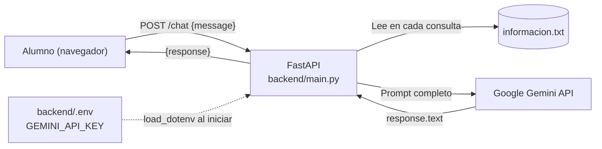
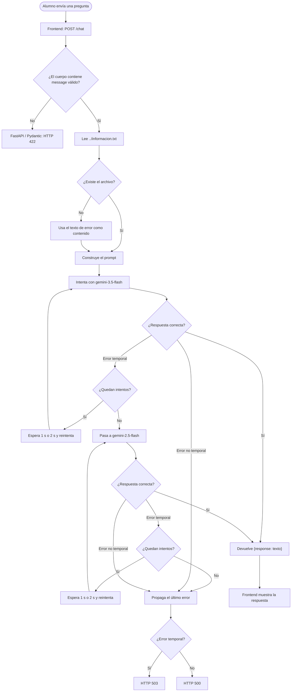

# Asistente virtual ISFDyT Nº 59

Chatbot embebible para la web del instituto. Los alumnos escriben una consulta en una burbuja de chat y reciben una respuesta generada por IA (Google Gemini), basada en la información institucional almacenada en `informacion.txt`.

---

## ¿Qué hace?

- Muestra un botón flotante 💬 que abre una ventana de chat.
- Envía la pregunta del alumno a un backend propio desarrollado con FastAPI.
- El backend lee `informacion.txt` en cada consulta.
- Construye un prompt con el rol del asistente, la información institucional y la pregunta del alumno.
- Envía el prompt a Google Gemini.
- Devuelve la respuesta en el campo `response`; el frontend puede mostrarla como Markdown.

### Características del backend

- La clave de Gemini se carga desde `backend/.env` y no debe exponerse en el navegador.
- La información institucional se vuelve a leer en cada pedido. Si se modifica `informacion.txt`, no hace falta reiniciar FastAPI para que el backend lea el nuevo contenido.
- Cada consulta es independiente: el backend no conserva el historial de conversación.
- Utiliza dos modelos de Gemini, en orden de preferencia:
  1. `gemini-3.5-flash` (principal).
  2. `gemini-2.5-flash` (respaldo).
- Realiza hasta tres intentos por modelo cuando detecta un error temporal.
- Aplica esperas progresivas de 1 y 2 segundos entre los intentos.
- Si se agotan los intentos de un modelo, pasa al siguiente.
- Si el error no es temporal, no continúa reintentando ni cambia de modelo: lo propaga para que la API lo gestione.

---

## Estructura del proyecto

```text
TpFinalChatYPaginaWeb/
├── Pagina-web-organizaciones/       # Sitio web (proyecto aparte)
└── Chat-Bot-organizaciones/         # Este proyecto
    ├── README.md
    ├── informacion.txt              # Base de conocimiento institucional
    ├── .gitignore
    ├── backend/
    │   ├── main.py                  # API FastAPI y lógica de Gemini
    │   ├── requirements.txt
    │   ├── .env                     # GEMINI_API_KEY (no subir a Git)
    │   └── .venv/                   # Entorno virtual
    └── frontend/
        └── index.html               # Widget de chat (HTML + CSS + JS)
```

> **Importante sobre la ruta de `informacion.txt`:** el backend abre el archivo mediante `../informacion.txt`. Esa ruta se resuelve desde el directorio de trabajo actual del proceso, no desde la ubicación física de `main.py`. Por eso, con la estructura indicada, iniciá Uvicorn desde la carpeta `backend/`.

---

## Arquitectura



## Flujo de una consulta



## Política de reintentos y modelos

El backend recorre la lista `MODELOS` en el orden definido en `main.py`.

| Orden | Modelo | Función |
|---|---|---|
| 1 | `gemini-3.5-flash` | Modelo principal |
| 2 | `gemini-2.5-flash` | Modelo de respaldo |

La constante `REINTENTOS_POR_MODELO = 3` establece un máximo de tres llamadas por modelo.

Para cada modelo, la espera comienza en 1 segundo y se duplica después de cada fallo temporal:

| Intento | Acción |
|---|---|
| 1 | Primera llamada |
| 2 | Si falla temporalmente, espera 1 segundo y reintenta |
| 3 | Si vuelve a fallar temporalmente, espera 2 segundos y reintenta |
| Fin | Si se agotan los intentos, pasa al siguiente modelo |

Por lo tanto, ante fallos temporales en ambos modelos, el backend puede realizar hasta seis llamadas a Gemini. Las esperas entre llamadas de un mismo modelo suman 3 segundos por modelo.

### ¿Qué errores considera temporales?

La función `es_error_temporal()` busca estas cadenas en el texto del error:

- `503`
- `UNAVAILABLE`
- `429`

Si encuentra alguna, el backend reintenta. Si no encuentra ninguna, vuelve a lanzar el error inmediatamente.

> Esta clasificación se basa en buscar texto dentro de la excepción; no utiliza códigos de estado estructurados. Por eso depende del formato del mensaje de error devuelto por la biblioteca de Gemini.

---

## Requisitos

| Componente | Versión / detalle |
|---|---|
| Windows | 10 u 11 |
| Git para Windows | Incluye Git Bash |
| Python | 3.10 o superior |
| Cuenta de Google | Para obtener una API key de Gemini |
| Navegador | Chrome, Edge, Firefox u otro moderno |
| Internet | El backend consulta a Gemini y el frontend puede cargar `marked` desde un CDN |

> Los comandos de instalación de esta guía se ejecutan en **Git Bash**, no en PowerShell ni en CMD. Las rutas se escriben con `/`. `<RUTA>` representa la carpeta que contiene `TpFinalChatYPaginaWeb`.

---

## Instalación en Windows (Git Bash)

### 1. Instalar Git y Python

1. Instalá [Git para Windows](https://git-scm.com/download/win), con las opciones predeterminadas.
2. Instalá [Python](https://www.python.org/downloads/windows/) y marcá **Add python.exe to PATH**.
3. Abrí Git Bash y verificá:

```bash
git --version
python --version
```

Si `python` no se reconoce o abre Microsoft Store, probá:

```bash
py --version
```

En ese caso, podés usar `py` para crear el entorno virtual.

### 2. Obtener la API key de Gemini

1. Entrá a [Google AI Studio - API keys](https://aistudio.google.com/apikey).
2. Creá una API key y copiala.
3. No la publiques ni la incluyas en el código del frontend o en Git.

### 3. Ubicarse en el proyecto

```bash
cd <RUTA>/TpFinalChatYPaginaWeb/Chat-Bot-organizaciones
ls
```

Deberías encontrar `README.md`, `backend/`, `frontend/` e `informacion.txt`.

Entrá al backend:

```bash
cd backend
```

> Si clonás el repositorio en otra PC, el archivo `.env` y el entorno `.venv` no vienen incluidos si están correctamente excluidos por Git. Tenés que crearlos siguiendo los pasos siguientes.

### 4. Crear y activar el entorno virtual

Desde `backend/`:

```bash
python -m venv .venv
source .venv/Scripts/activate
```

En Windows, el script de activación está en `.venv/Scripts/`, no en `.venv/bin/` como en Linux.

Cuando esté activo, el prompt muestra `(.venv)`. Para salir:

```bash
deactivate
```

### 5. Instalar las dependencias

Con el entorno virtual activo:

```bash
python -m pip install --upgrade pip
pip install -r requirements.txt
```

El archivo `requirements.txt` debe incluir las dependencias utilizadas por el backend, como:

- `fastapi`
- `uvicorn[standard]`
- `python-dotenv`
- `google-genai`
- `pydantic`

### 6. Configurar la API key

Desde `backend/`, creá el archivo `.env`:

```bash
cat > .env << 'EOF'
GEMINI_API_KEY=tu_clave_aqui
EOF
```

Reemplazá `tu_clave_aqui` por la clave real. No compartas el contenido del archivo ni lo subas al repositorio.

El backend ejecuta `load_dotenv()` al iniciar y obtiene la clave mediante:

```python
api_key = os.getenv("GEMINI_API_KEY")
client = genai.Client(api_key=api_key)
```

### 7. Verificar `.gitignore`

En la raíz de `Chat-Bot-organizaciones/`, asegurate de tener un `.gitignore` que excluya los archivos sensibles y temporales:

```gitignore
.env
.venv/
__pycache__/
*.pyc
```

Si el `.env` ya fue incorporado al seguimiento de Git, quitarlo del índice y generar una API key nueva:

```bash
git rm --cached backend/.env
```

Si hay archivos `__pycache__` versionados, también podés quitarlos del índice:

```bash
git rm -r --cached backend/__pycache__
```

### 8. Cargar la información del instituto

Editá `informacion.txt`, ubicado en la raíz del proyecto, un nivel arriba de `backend/`.

Guardalo en **UTF-8**. Podés usar VS Code:

```bash
code ../informacion.txt
```

Ejemplo de organización:

```text
== INSCRIPCIONES ==
Período: ...
Requisitos: ...

== CARRERAS ==
Profesorado de ...
Tecnicatura en ...

== CONTACTO ==
Secretaría: ...
Horario de atención: ...
```

El backend vuelve a leer este archivo en cada solicitud. No es necesario reiniciar Uvicorn después de modificarlo.

**Atención:** si el archivo no existe, el código actual no detiene la consulta. En su lugar, asigna el texto `Error: No se encontró el archivo informacion.txt.` a la variable de información y lo incorpora al prompt.

### 9. Iniciar el backend

Asegurate de estar dentro de `backend/` y de tener activo el entorno virtual:

```bash
uvicorn main:app --host 127.0.0.1 --port 8000 --reload
```

Dejá esa terminal abierta. Para detener el servidor, presioná `Ctrl + C`.

Comprobá el endpoint principal desde otra terminal:

```bash
curl http://127.0.0.1:8000/
```

Respuesta esperada:

```json
{
  "status": "ok",
  "message": "Asistente ISFDyT 59 con IA de Google"
}
```

Probá el chat directamente:

```bash
curl -X POST http://127.0.0.1:8000/chat \
  -H "Content-Type: application/json" \
  -d '{"message":"Hola, ¿qué carreras hay?"}'
```

La respuesta exitosa tiene esta estructura:

```json
{
  "response": "Texto generado por Gemini..."
}
```

También podés abrir la documentación interactiva de FastAPI:

<http://127.0.0.1:8000/docs>

### 10. Abrir el frontend

**Opción A: abrir el archivo directamente**

Desde Git Bash:

```bash
start ../frontend/index.html
```

**Opción B: servidor local para el frontend**

En una segunda terminal:

```bash
cd <RUTA>/TpFinalChatYPaginaWeb/Chat-Bot-organizaciones/frontend
python -m http.server 5500
```

Abrí:

<http://127.0.0.1:5500/index.html>

Hacé clic en 💬 y probá una pregunta. Verificá que la URL configurada en el `fetch` del frontend apunte al backend correcto.

---

## Uso diario

Cada vez que quieras iniciar el proyecto:

```bash
cd <RUTA>/TpFinalChatYPaginaWeb/Chat-Bot-organizaciones/backend
source .venv/Scripts/activate
uvicorn main:app --host 127.0.0.1 --port 8000 --reload
```

No es necesario reiniciar el backend cuando solamente modificás `informacion.txt`.

---

## Configuración del backend

| Configuración | Ubicación | Funcionamiento |
|---|---|---|
| API key | `backend/.env` → `GEMINI_API_KEY` | Clave necesaria para acceder a Gemini |
| Modelos | `backend/main.py` → `MODELOS` | Lista ordenada de modelos principal y respaldo |
| Reintentos | `backend/main.py` → `REINTENTOS_POR_MODELO` | Cantidad máxima de intentos por modelo |
| Errores temporales | `backend/main.py` → `es_error_temporal()` | Busca `503`, `UNAVAILABLE` o `429` en el error |
| Espera progresiva | `backend/main.py` → `generar_respuesta()` | Espera 1 y luego 2 segundos entre reintentos |
| Prompt | `backend/main.py` → `prompt_completo` | Define el rol del asistente y el contenido enviado a Gemini |
| Información institucional | `informacion.txt` | Se lee en cada consulta |
| URL del backend | `frontend/index.html` → `fetch()` o `API_URL` | Debe apuntar a la dirección de FastAPI |
| Puerto | Inicio de Uvicorn | En esta guía se utiliza el puerto `8000` |
| CORS | `backend/main.py` → `allow_origins` | Actualmente permite todos los orígenes (`["*"]`) |

### Endpoints disponibles

| Método | Ruta | Función |
|---|---|---|
| GET | `/` | Comprueba que la API está activa |
| POST | `/chat` | Recibe la pregunta y devuelve la respuesta de Gemini |
| GET | `/docs` | Documentación interactiva automática de FastAPI |

### Formato de la solicitud

El endpoint `/chat` recibe un objeto JSON con el campo `message`:

```json
{
  "message": "¿Qué carreras ofrece el instituto?"
}
```

El modelo Pydantic `ChatRequest` valida que el campo sea una cadena de texto.

### Tratamiento de errores HTTP

| Código | Situación |
|---|---|
| 200 | Consulta procesada y respuesta devuelta |
| 422 | Solicitud inválida, por ejemplo, falta `message` o no es una cadena |
| 503 | Se agotaron los intentos y el último error fue identificado como temporal |
| 500 | Error interno no clasificado como temporal |

---

## Solución de problemas

| Síntoma | Causa probable | Qué revisar |
|---|---|---|
| `source: .venv/bin/activate: No such file` | Se usó la ruta de activación de Linux | En Git Bash para Windows: `source .venv/Scripts/activate` |
| `python: command not found` | Python no está en PATH | Reinstalar agregando Python al PATH o probar `py` |
| `uvicorn: command not found` | Entorno virtual inactivo o dependencias ausentes | Activar `.venv` e instalar `requirements.txt` |
| `ModuleNotFoundError: No module named 'google'` | Falta la biblioteca de Gemini | Ejecutar `pip install -r requirements.txt` |
| El chat dice que no puede conectar | Backend detenido o URL incorrecta | Comprobar `curl http://127.0.0.1:8000/` y la URL del frontend |
| No encuentra `informacion.txt` | Uvicorn se inició desde otro directorio o el archivo no existe | Iniciar desde `backend/` y verificar `../informacion.txt` |
| HTTP 500 y error de API key | Clave incorrecta, ausente o `.env` mal ubicado | Revisar `backend/.env` y `GEMINI_API_KEY` sin compartir la clave |
| Error `404` de modelo | Nombre de modelo no disponible para la API o cuenta | Revisar los nombres de `MODELOS` y los modelos disponibles |
| HTTP 503 | Se agotaron los intentos ante errores reconocidos como temporales | Revisar la conectividad, disponibilidad y cuota de Gemini; consultar la consola del backend |
| HTTP 500 | Error no reconocido como temporal | Revisar el detalle de la excepción en la terminal del backend |
| HTTP 429 | Gemini informó límite de solicitudes o cuota | El backend lo trata como temporal y reintenta; si persiste, revisar los límites de la API |
| Error de CORS | El origen del frontend no coincide con la política del backend | Revisar `allow_origins` y la configuración CORS |
| Tildes y ñ se ven mal | Archivo guardado con otra codificación | Guardar `informacion.txt` en UTF-8 |
| Puerto 8000 ocupado | Otra instancia está usando el puerto | Detener la instancia anterior o elegir otro puerto y actualizar el frontend |

> Los mensajes de error de Gemini se imprimen en la consola del backend. Son útiles para diagnosticar si falló el modelo principal, si se pasó al modelo de respaldo o si el problema no fue clasificado como temporal.

---

## Antes de publicarlo en la web del instituto

1. **Backend accesible desde internet:** `127.0.0.1` solo permite conexiones desde la propia máquina. Para producción, desplegá FastAPI en un servidor accesible y configurá correctamente el acceso desde el frontend.
2. **CORS:** reemplazá `allow_origins=["*"]` por los dominios reales que deban acceder a la API. Para producción, revisá también la combinación de orígenes permitidos y `allow_credentials=True`.
3. **Límite de uso:** cualquier persona que pueda acceder al endpoint podría consumir la cuota de Gemini. Incorporá límites de solicitudes por IP, por ejemplo con `slowapi`, y otras medidas contra abuso.
4. **Seguridad del frontend:** si se representa Markdown como HTML, sanitizá el resultado antes de insertarlo en el documento, por ejemplo con DOMPurify. Usá `textContent` para insertar texto escrito por el usuario.
5. **Respuestas confiables:** el prompt pide basarse en la información institucional, pero eso no garantiza que el modelo no cometa errores. Conviene agregar una instrucción explícita para que indique que no tiene información cuando la respuesta no figure en el archivo y derive la consulta a Secretaría.
6. **Archivo institucional:** verificá que `informacion.txt` esté actualizado, sea accesible por el proceso y no contenga información privada que no deba enviarse a un proveedor externo.
7. **Ejecución continua:** en Linux podés ejecutar FastAPI como servicio con systemd y ubicarlo detrás de un proxy inverso. En Windows podés evaluar NSSM o el Programador de tareas.
8. **Clave de Gemini:** mantené `.env` fuera del repositorio y restringí el acceso al servidor.

### Nota sobre CORS

La configuración actual utiliza:

```python
allow_origins=["*"],
allow_credentials=True,
allow_methods=["*"],
allow_headers=["*"],
```

Es una configuración amplia y no es la recomendada para producción. Definí los orígenes concretos que utilizarán el backend y revisá si realmente necesitás permitir credenciales.

---

## Integración con la página web

El repositorio incluye `Pagina-web-organizaciones/`. Para integrar el chat:

1. Copiá el HTML del botón y de la ventana de chat, junto con el CSS y JavaScript de `frontend/index.html`, dentro de la página institucional, antes de `</body>`.
2. Incluí las dependencias del frontend, como `marked` y, si corresponde, DOMPurify.
3. Configurá la URL de FastAPI en el `fetch` o en la constante `API_URL`.
4. Asegurate de que el dominio de la página esté permitido por CORS.
5. Probá el envío de preguntas desde el sitio publicado, no solamente desde localhost.

---

## Limitaciones conocidas

- **Sin memoria de conversación:** cada pregunta se procesa de manera independiente. No se envía un historial de mensajes anteriores.
- **Información completa en cada consulta:** el archivo entero se incorpora al prompt. Para una base de conocimiento pequeña es sencillo; si crece mucho, convendrá recuperar solamente la información relevante.
- **La instrucción no garantiza exactitud:** pedirle al modelo que responda estrictamente según el archivo no impide por completo respuestas incorrectas o información inventada. Los datos importantes deben verificarse con el instituto.
- **Archivo ausente:** actualmente, si no se encuentra `informacion.txt`, el backend incorpora un mensaje de error al prompt y continúa con Gemini. No devuelve un error específico por archivo faltante.
- **Detección de errores por texto:** la función `es_error_temporal()` busca fragmentos de texto (`503`, `UNAVAILABLE`, `429`). No analiza códigos de estado estructurados.
- **Reintentos y cuota:** los reintentos pueden generar llamadas adicionales a la API y no garantizan que el servicio se recupere.
- **Sin límite de solicitudes propio:** el código actual no implementa rate limiting ni autenticación para `/chat`.

---

## Tecnologías

Python · FastAPI · Uvicorn · Pydantic · Google Gemini (`google-genai`) · `python-dotenv` · HTML · CSS · JavaScript · `marked.js` · Git · Git Bash
