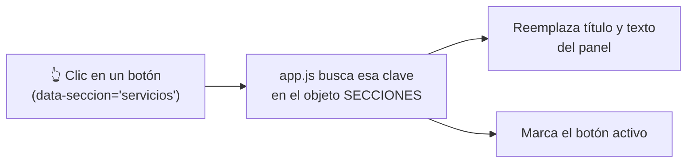
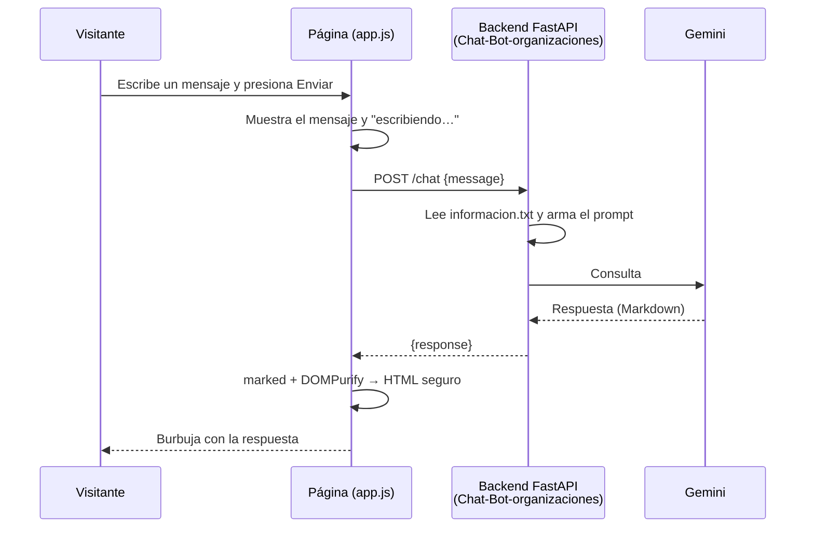
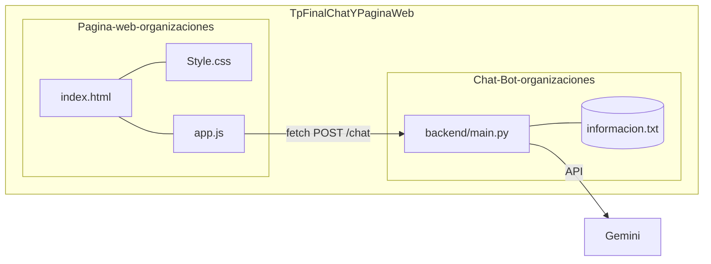

# Terraform Cyberspace — Página web

Página informativa de **Terraform Cyberspace**, empresa de inteligencia artificial y desarrollo web. Tiene un menú con información de la empresa y un **chat flotante** conectado al asistente virtual del proyecto hermano `Chat-Bot-organizaciones`.

Está hecha solo con HTML, CSS y JavaScript (sin frameworks ni instalación): se abre en el navegador.

---

## Contenido de la carpeta

```
Pagina-web-organizaciones/
├── index.html                 ← estructura de la página (qué hay)
├── Style.css                  ← diseño (cómo se ve)
├── app.js                     ← comportamiento (qué hace)
├── img/
│   ├── logo Terraform Cyberspace.png
│   └── fondoweb.png
├── Diagrama de flujo.drawio
└── Readme.md
```

| Archivo | Para qué sirve | Se edita cuando querés… |
|---|---|---|
| `index.html` | Define los bloques: encabezado, portada, tarjetas, pie y la ventana del chat | agregar o quitar secciones |
| `Style.css` | Colores, tipografías, tamaños, animaciones y el diseño del chat | cambiar el aspecto |
| `app.js` | Hace funcionar los botones del menú y el chat | cambiar textos o la conexión con el backend |

Una forma fácil de recordarlo: **HTML es el esqueleto, CSS la ropa y JavaScript los músculos.**

---

## Cómo funciona

### 1. Menú informativo

Los cinco botones del encabezado (`¿Quiénes somos?`, `Servicios`, `Contacto`, `Soporte`, `Noticias`) cambian el recuadro de la portada.



- Cada botón en `index.html` lleva un atributo `data-seccion` (por ejemplo `data-seccion="contacto"`).
- En `app.js`, el objeto `SECCIONES` guarda el título y el texto de cada una.
- La función `mostrarSeccion(clave)` actualiza el panel. Al cargar la página se muestra `inicio`.

### 2. Chat flotante

El botón 💬 abre una ventana de chat. Cuando el visitante envía un mensaje, la página **no habla directamente con la IA**: se lo manda a un backend propio, que es quien consulta a Gemini con la API key.



Por qué así:

- **La API key nunca está en la página.** Vive en el `.env` del backend; si estuviera en el JavaScript, cualquiera podría verla.
- **Seguridad:** el texto del usuario se muestra como texto plano y la respuesta del bot se sanitiza con DOMPurify antes de convertirla en HTML.
- Si el backend no responde, el chat muestra un aviso en lugar de romperse.

### Cómo se relacionan los proyectos



Son dos proyectos independientes: la página se puede abrir sin el chat (el botón 💬 mostrará "No pude conectarme…"), y el backend funciona con cualquier página que le envíe `{ "message": "..." }`.

---

## Cómo ejecutarla (Git Bash en Windows)

Necesitás dos terminales, porque hay dos servidores: el del chat y el de la página. `<RUTA>` es la carpeta que contiene `TpFinalChatYPaginaWeb`.

**Terminal 1 — backend del chat** (instalación completa en `Chat-Bot-organizaciones/README.md`):

```bash
cd <RUTA>/TpFinalChatYPaginaWeb/Chat-Bot-organizaciones/backend
source .venv/Scripts/activate
uvicorn main:app --host 127.0.0.1 --port 8000 --reload
```

**Terminal 2 — la página:**

```bash
cd <RUTA>/TpFinalChatYPaginaWeb/Pagina-web-organizaciones
python -m http.server 5500
```

Abrí <http://127.0.0.1:5500> en el navegador.

> Sin backend, la página funciona igual, pero el chat no podrá responder. También podés abrir `index.html` con doble clic; se recomienda `http.server` porque se parece más a cómo se verá publicada.

---

## Personalización rápida

| Quiero cambiar… | Dónde |
|---|---|
| Los textos de los botones del menú | `SECCIONES` en `app.js` (y el texto del botón en `index.html`) |
| Agregar un botón nuevo | Un `<button data-seccion="clave">` en `index.html` y una entrada `clave: {...}` en `SECCIONES` |
| Colores | Variables al inicio de `Style.css` (`:root`: `--bg`, `--accent`, etc.) |
| Imagen de fondo de la portada | `.hero` en `Style.css` (`url("img/fondoweb.png")`) |
| Logo | `img/logo Terraform Cyberspace.png` y el `` del encabezado en `index.html` |
| Tarjetas "Qué hacemos" | Bloques `<article class="card">` en `index.html` |
| Título y saludo del chat | `#chat-header` y el primer `.bot-message` en `index.html` |
| Dirección del backend | `CONFIG.chatApiUrl` al inicio de `app.js` |

---

## Publicación en un servidor propio

1. Subí los archivos de esta carpeta al directorio que sirve nginx (por ejemplo `/var/www/terraform`).
2. Dejá el backend corriendo (idealmente como servicio de systemd) en `127.0.0.1:8000`.
3. Hacé que nginx reenvíe `/chat` al backend, así la página y el chat comparten dominio y no hay problemas de CORS:

```nginx
server {
    listen 80;
    server_name tu-dominio.com;
    root /var/www/terraform;
    index index.html;

    location / {
        try_files $uri $uri/ =404;
    }

    location = /chat {
        proxy_pass http://127.0.0.1:8000/chat;
        proxy_set_header Host $host;
        proxy_set_header X-Real-IP $remote_addr;
        proxy_read_timeout 60s;
    }
}
```

4. En `app.js` cambiá la configuración:

```js
chatApiUrl: '/chat',
```

5. Agregá HTTPS (por ejemplo con Certbot) y limitá `allow_origins` en el backend al dominio real.

---

## Problemas frecuentes

| Síntoma | Causa probable | Solución |
|---|---|---|
| El chat dice "No pude conectarme con el servidor" | El backend no está corriendo o la URL no coincide | Verificá `curl http://127.0.0.1:8000/` y `CONFIG.chatApiUrl` |
| Error de CORS en la consola del navegador | La página y el backend están en orígenes distintos y el backend no lo permite | Revisá `allow_origins` en `main.py`, o usá el proxy de nginx |
| Las respuestas del bot se ven como texto con `**` y `-` | No cargaron `marked` / `DOMPurify` (sin internet o CDN bloqueado) | Revisá la conexión; el chat sigue funcionando en texto plano |
| No se ve el fondo ni el logo | Ruta o nombre de archivo incorrecto (en Linux importan las mayúsculas) | Comprobá que `img/` tenga los nombres exactos |
| No se aplican los estilos | El archivo se llama distinto a como lo enlaza el HTML | El enlace es `Style.css`; el archivo debe llamarse igual, con mayúscula inicial |
| Cambios que no se ven | El navegador guarda la versión anterior | Recargá con `Ctrl + F5` |

---

## Trabajo en equipo con Git

- Hacé commits chicos y con mensajes claros (por ejemplo: `Agrega tarjetas de servicios`).
- Cada integrante puede trabajar en una rama propia y unirla luego a la principal.
- El `.env` del backend **no se sube**: contiene la API key.
- Antes de empezar a trabajar: `git pull`. Al terminar: `git add`, `git commit`, `git push`.

---

## Documentación relacionada

- `../Chat-Bot-organizaciones/README.md` — instalación del backend, configuración de Gemini y diagrama de flujo del chat.
- `Diagrama de flujo.drawio` — diagrama del proyecto (abrir con [diagrams.net](https://app.diagrams.net/)).
